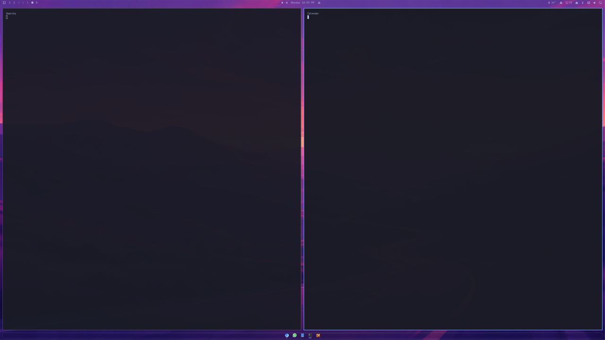
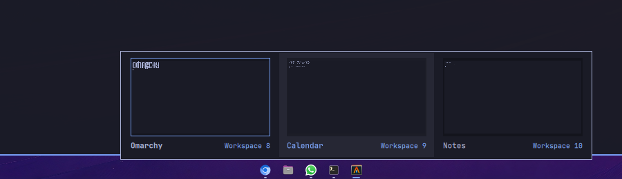
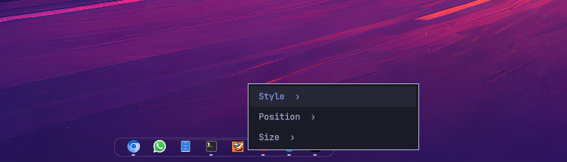
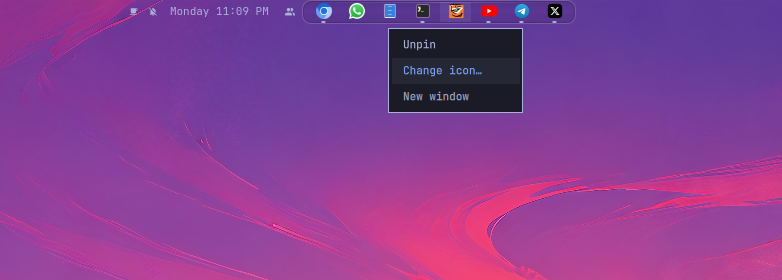

# Omarchy Taskbar

[English](README.md) · **Español**

Una barra de tareas limpia para [Omarchy](https://omarchy.org/), dibujada con
los mismos valores del tema que la barra original. Tiene tus aplicaciones
ancladas y muestra todas las abiertas, centradas.






## Funciones

- Primero las apps ancladas y después cualquier otra abierta. Posición: arriba,
  derecha, izquierda, abajo o **Combinar** como módulo de la barra de Omarchy.

  
  

- Clic derecho en un espacio vacío para estilo Predeterminado o Crystal, escala
  de iconos y largo (**Auto** ajusta el largo a los iconos).

  
  
  

- **Clic izquierdo** abre o enfoca una app (y oculta un scratchpad abierto);
  **clic central** abre una ventana nueva; **clic derecho** ancla, desancla o cierra.
- **Arrastra iconos** para reordenar los anclajes, o **arrastra archivos**
  (`.desktop`, `.exe`/`.msi`, programas, AppImages) a la barra para anclarlos.
- **Cambiar icono…** en una app anclada pone un icono PNG, SVG, ICO o EXE
  propio; **Restaurar icono** lo deshace.

  
  

- Doble clic en un espacio vacío para una barra transparente; al pulsar una app
  con varias ventanas eliges una miniatura y saltas a su escritorio.
- Las aplicaciones web muestran su propio icono. Inglés y español, según el sistema.

## Segura por diseño

No instala nada ni necesita permisos de administrador. Reacciona a eventos y
nunca consulta en bucle. Los iconos propios se validan por contenido, los EXE
nunca se ejecutan y el plugin no instala paquetes; los iconos SVG, ICO y EXE
usan `rsvg-convert`, `icotool` y `wrestool` si ya los tienes. Los ajustes viven
en `~/.config/omarchy-taskbar/` con permisos solo para tu usuario. Consulta
[SECURITY.md](SECURITY.md).

## Instalar, actualizar y quitar

```bash
omarchy plugin add https://github.com/gsus67/omarchy-taskbar.git --enable
omarchy plugin update io.github.gsus67.omarchy-taskbar
omarchy plugin remove io.github.gsus67.omarchy-taskbar
```

Después de actualizar, ejecuta `omarchy restart shell`. Para borrar lo que
quede tras quitarlo:

```bash
rm -rf -- ~/.config/omarchy-taskbar
rm -f -- ~/.local/share/applications/omarchy-taskbar/*.desktop \
  ~/.local/share/applications/omarchy-taskbar-*.desktop \
  ~/.local/share/icons/hicolor/256x256/apps/omarchy-taskbar-*.png
rmdir -- ~/.local/share/applications/omarchy-taskbar 2>/dev/null || true
```

## Desarrollo

```bash
python3 -m unittest discover -s tests -v
QT_QPA_PLATFORM=offscreen QT_QUICK_BACKEND=software /usr/lib/qt6/bin/qmltestrunner -input tests/qml
python3 scripts/check_native_settings.py
```

Consulta también el [historial de cambios](CHANGELOG.md).

## Licencia

[MIT](LICENSE)
