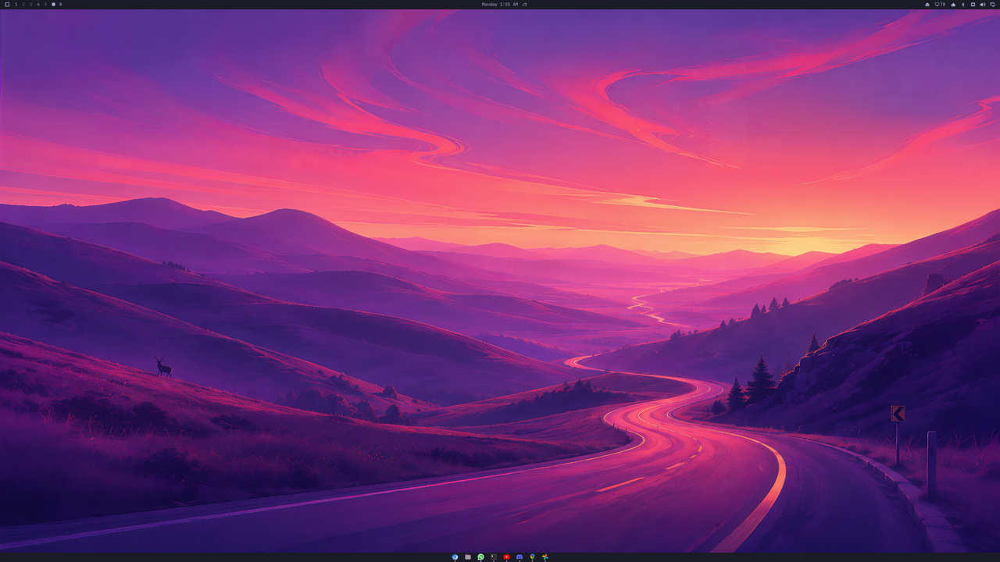
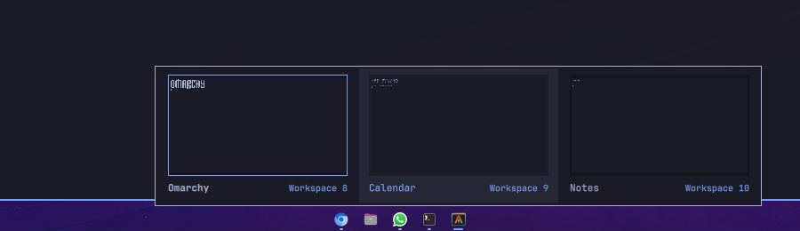

# Omarchy Taskbar

[English](README.md) · **Español**

Una barra inferior limpia para [Omarchy](https://omarchy.org/), del mismo ancho
que la barra original y dibujada con los mismos valores del tema (tamaño,
colores, fuente y transparencia), así que cambia junto con tu tema. Tiene tus
aplicaciones ancladas para abrirlas rápido y muestra todas las que están
abiertas, siempre centradas.


La barra de cerca, con apps ancladas, apps abiertas y aplicaciones web con su
propio icono:




Con doble clic en un espacio vacío se vuelve transparente, junto con la barra
de Omarchy:


Al pulsar una app con varias ventanas, puedes elegir una miniatura para abrirla en su escritorio.



## Funciones

- Una barra en el borde inferior de cada pantalla; las ventanas le dejan sitio.
- Primero las apps ancladas y después cualquier otra que abras, centradas y
  creciendo desde el medio.
- Una marca corta debajo de las apps con ventanas abiertas; la app con el foco
  tiene una marca más ancha del color de acento.
- **Clic izquierdo**: abre la app o la enfoca; si ya tiene el foco y varias
  ventanas, pasa a la siguiente.
- **Clic central**: ventana nueva.
- **Arrastrar iconos de apps**: reordena los anclajes con la misma vista flotante
  y el mismo marcador de inserción que la barra superior de Omarchy. Suelta una
  app abierta entre los anclajes para anclarla ahí. El orden se guarda en
  `pinned.json` y se comparte en todas las pantallas. Soltar fuera de la
  barra cancela; soltar sobre el mismo icono no cambia nada.
- **Arrastrar archivos a cualquier barra**: ancla accesos de escritorio,
  archivos de Windows (`.exe`/`.msi`) y programas ejecutables o AppImages al
  final de tus anclajes.
- **Varias ventanas de una app**: un clic muestra una miniatura de cada una con su escritorio (una sola captura, solo mientras la lista está abierta); eliges una y la barra te lleva a ella, aunque esté en otro escritorio.
- **Clic derecho**: anclar/desanclar, ventana nueva, cerrar. Ventana nueva funciona con todas las apps, también con ventanas sin entrada de escritorio (como una terminal abierta con su propia clase).
- **Iconos de aplicaciones**: las apps abiertas desde una terminal o un script pueden mostrar su propio icono.
- **Aplicaciones web** (las de `omarchy-webapp-install`): muestran su propio icono, tienen su propio botón y se pueden anclar, en vez de salir como el navegador.
- **Doble clic en una zona vacía**: activa o quita la transparencia, igual que
  la barra de Omarchy. Las dos barras comparten el mismo ajuste
  (`bar.transparent` en `shell.json`), así que el doble clic en cualquiera
  cambia ambas.
- Inglés y español, según el idioma del sistema.

## Ligera

No instala nada ni necesita permisos de administrador. Solo usa lo que Omarchy
ya trae: la lista de
ventanas, los accesos de aplicaciones y el tema de iconos de Quickshell, los
valores del tema de Omarchy, `omarchy bar transparent` y `uwsm-app` para abrir
apps. Reacciona a eventos (ventanas que se abren o cierran, cambios de archivo)
y nunca consulta en bucle.

La primera vez ancla tu navegador predeterminado
(`omarchy-cmd-default-browser`), el gestor de archivos y la terminal. Una
ventana cuya clase no tiene acceso de aplicación (por ejemplo
`alacritty --class=org.omarchy.agent`) usa el icono del programa que hay
detrás, consultado una sola vez con `hyprctl`.

## Anclar archivos arrastrándolos

Arrastra un archivo compatible desde el gestor de archivos a cualquier barra.
Los archivos `.desktop` instalados usan su id de entrada; los accesos que vienen
de otro sitio se copian a tu carpeta de aplicaciones de usuario. Los programas
y AppImages necesitan permiso de ejecución. Los archivos de Windows se abren
con la aplicación predeterminada del sistema para su tipo de archivo,
incluido GE-Proton si lo tienes configurado como controlador.

Para los archivos `.exe`, la barra extrae un icono si `wrestool` e `icotool`
(icoutils) ya están instalados; si no, usa un icono genérico de ejecutable.
Nunca instala paquetes. Se ignoran las rutas con `%` o caracteres de control,
los archivos no compatibles y los elementos que no sean archivos. Haz clic
derecho en el anclaje y elige **Desanclar** para quitarlo junto con el acceso y
el icono generados; el archivo original permanece en su sitio.

## Instalar, actualizar y quitar

```bash
omarchy plugin add https://github.com/gsus67/omarchy-taskbar.git --enable
omarchy plugin update io.github.gsus67.omarchy-taskbar
omarchy plugin remove io.github.gsus67.omarchy-taskbar
```

Después de actualizar, ejecuta `omarchy restart shell` para que el shell cargue
el código nuevo.

## Archivos

- `~/.config/omarchy-taskbar/pinned.json`: tus apps ancladas (ids de los
  accesos, en orden). Puedes editarlo a mano; la barra recoge los cambios al
  momento.
- `~/.config/omarchy-taskbar/config.json`: ajustes opcionales de apariencia,
  aplicados al momento. El clic derecho en un espacio vacío abre **Estilo** y
  **Tamaño**. **Predeterminado** hereda el tema y la transparencia de la barra
  superior. **Crystal** añade una superficie translúcida y redondeada con
  reflejos y espacio en los extremos. Se dibuja localmente; el desenfoque del
  fondo requiere soporte del compositor y el plugin no lo activa.
  En **Tamaño → Ancho** se elige **0,75x**, **0,9x**, **1x** (predeterminado),
  **1,25x**, **1,5x** o **2x**. En **Largo**, desde **Completo** hasta **10%**,
  de diez en diez puntos. Ambas opciones están en los dos estilos. El largo
  elegido es el mínimo: la barra crece para albergar los iconos y vuelve a
  reducirse al cerrar aplicaciones, hasta el máximo de cada pantalla. Crystal
  mantiene un pequeño margen incluso en Completo. Si los iconos superan ese
  máximo, se recorren con la rueda. Los menús siguen el idioma español/inglés
  del sistema.
  Ejemplo: `{"style": "crystal", "scale": 0.9, "width": "20%"}`. Se conservan
  los largos en píxeles editados a mano. Elegir un valor predeterminado retira
  solo ese ajuste y conserva los demás; si el archivo queda vacío se borra.
  Si un ajuste falta o no es válido, se usa Predeterminado, 1x y largo completo.
  El doble clic para alternar la transparencia se conserva en Predeterminado
  y sigue controlando ambas barras nativas.
- `~/.local/share/applications/omarchy-taskbar/<hash>.desktop`: accesos
  generados y copias de `.desktop` externos. El directorio es privado (`0700`)
  y el acceso a los lanzadores se limita a tu usuario (`0600`). Los accesos
  planos existentes se mueven allí al reparar sus anclajes al iniciar.
- `~/.local/share/icons/hicolor/256x256/apps/omarchy-taskbar-<hash>.png`:
  iconos extraídos de archivos de Windows, cuando están disponibles.

Al desanclar se eliminan el acceso y el icono generados. Después de quitar el
plugin, borra los anclajes y archivos generados que queden con:

```bash
rm -rf -- ~/.config/omarchy-taskbar
rm -f -- ~/.local/share/applications/omarchy-taskbar/*.desktop \
  ~/.local/share/applications/omarchy-taskbar-*.desktop \
  ~/.local/share/icons/hicolor/256x256/apps/omarchy-taskbar-*.png
rmdir -- ~/.local/share/applications/omarchy-taskbar 2>/dev/null || true
```

## Comprobaciones de desarrollo

```bash
python3 -m unittest discover -s tests -v
QT_QPA_PLATFORM=offscreen QT_QUICK_BACKEND=software /usr/lib/qt6/bin/qmltestrunner -input tests/qml
python3 scripts/check_native_settings.py
```

Las pruebas QML y de ajustes nativos usan Qt/Quickshell ya instalados. La prueba
nativa de ajustes escribe solo en un directorio temporal aislado.
Consulta el [historial de cambios](CHANGELOG.md).

## Licencia

[MIT](LICENSE)
