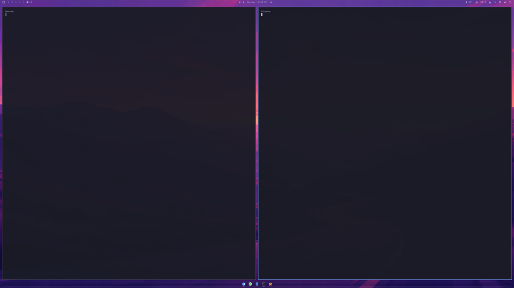
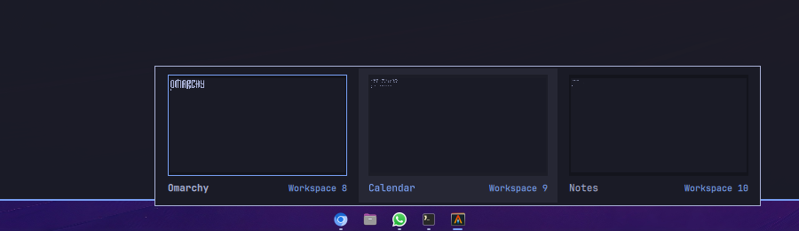
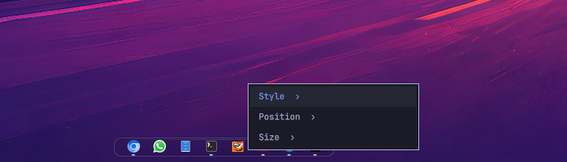
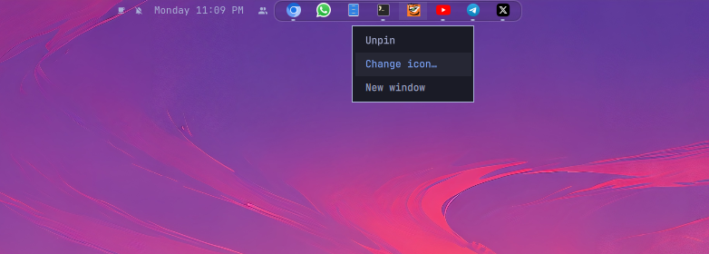

# Omarchy Taskbar

**English** · [Español](README.es.md)

A clean taskbar for [Omarchy](https://omarchy.org/), drawn with the same theme
tokens as the original bar. It holds your pinned apps and shows every open app,
centered.






## Features

- Pinned apps first, then any other open app. Position: top, right, left,
  bottom, or **Combine** as a module of Omarchy's bar.

  
  

- Right-click empty space for Default or Crystal style, icon scale and length
  (**Auto** fits the length to the icons).

  
  
  

- **Left click** opens or focuses an app (and hides an open scratchpad);
  **middle click** opens a new window; **right click** pins, unpins or closes.
- **Drag icons** to reorder pins, or **drag files** (`.desktop`, `.exe`/`.msi`,
  programs, AppImages) onto the bar to pin them.
- **Change icon…** on a pinned app sets a custom PNG, SVG, ICO or EXE icon;
  **Restore icon** undoes it.

  
  

- Double-click empty space for a transparent bar, and click an app with several
  windows to pick a thumbnail and jump to its workspace.
- Web apps show their own icon. English and Spanish, following the system.

## Safe by design

Nothing to install and no administrator permissions. It reacts to events and
never polls. Custom icons are validated by content, EXE files are never run,
and the plugin never installs packages; SVG, ICO and EXE icons use
`rsvg-convert`, `icotool` and `wrestool` if you already have them. Settings live
in `~/.config/omarchy-taskbar/` with owner-only permissions. See
[SECURITY.md](SECURITY.md).

## Install, update and remove

```bash
omarchy plugin add https://github.com/gsus67/omarchy-taskbar.git --enable
omarchy plugin update io.github.gsus67.omarchy-taskbar
omarchy plugin remove io.github.gsus67.omarchy-taskbar
```

After an update, run `omarchy restart shell`. To delete leftovers after
removal:

```bash
rm -rf -- ~/.config/omarchy-taskbar
rm -f -- ~/.local/share/applications/omarchy-taskbar/*.desktop \
  ~/.local/share/applications/omarchy-taskbar-*.desktop \
  ~/.local/share/icons/hicolor/256x256/apps/omarchy-taskbar-*.png
rmdir -- ~/.local/share/applications/omarchy-taskbar 2>/dev/null || true
```

## Development

```bash
python3 -m unittest discover -s tests -v
QT_QPA_PLATFORM=offscreen QT_QUICK_BACKEND=software /usr/lib/qt6/bin/qmltestrunner -input tests/qml
python3 scripts/check_native_settings.py
```

See also the [changelog](CHANGELOG.md).

## License

[MIT](LICENSE)
